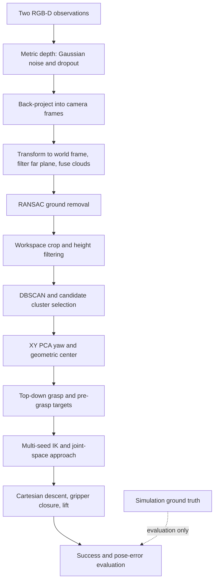

# RGB-D Perception-Guided Robot Grasping

## Overview

A geometry-based manipulation system that uses two simulated RGB-D cameras to localize a randomly sized cuboid and guide a Franka Panda through approach, grasp, and lift in PyBullet. The project connects point-cloud processing, pose estimation, grasp geometry, inverse kinematics, and measurable execution outcomes in a modular Python implementation.

Perception runs once before execution. This is **perception-guided, visually open-loop manipulation**, not real-time visual servoing. It uses classical geometry, with no trained model or learning-based perception. Low-level joint position control operates during execution.

**Ground truth is used only for evaluation, not perception or planning.** Scene generation necessarily specifies the simulated object's true geometry and pose; afterward, true position/yaw are used only to calculate errors, including the IK-failure branch. Object identity is used to measure final height. Neither ground-truth pose nor the renderer's segmentation mask supplies the grasp target.

## System Pipeline



## Project Structure

```text
scripts/
  run_single_trial.py       GUI demonstration
  run_benchmark.py          Batch evaluation and optional JSON export
src/
  config.py                Scene, camera, perception, and motion settings
  pipeline.py              Single-trial orchestration
  simulation/              Scene generation and connection lifetime
  perception/              RGB-D, point clouds, segmentation, and pose estimation
  planning/                Grasp and pre-grasp geometry
  control/                 Robot links, IK, motion, and gripper control
  evaluation/              Metrics and benchmark aggregation
  geometry/                Earlier rotation utilities
tests/                     Refactor source and behavioral comparison tools
results/                   Saved original/refactored results and verification logs
notes/                     Experiment evidence and learning records
exercises/                 Historical learning scripts and final_version.py
roadmap/                   Historical learning plan
requirements.txt           Runtime dependencies
```

The modular scripts are the current entry points. `exercises/final_version.py` remains the historical reference. Earlier learning plans describe goals beyond current functionality.

## Methodology

### RGB-D perception and fusion

Two fixed 640 × 480 cameras observe the workspace from `[0.7, 0.7, 1.2]` and `[0.7, -0.7, 1.2]` metres. Depth-buffer values are converted to metric depth before adding zero-mean Gaussian noise and independent pixel dropout. Dropped pixels are assigned the 3 m far plane; depths at or above 2.99 m are removed. Depth points are back-projected, transformed into the world frame using known camera extrinsics, and concatenated. RGB is captured, but the pose estimator uses depth geometry.

### Ground removal and object segmentation

RANSAC removes plane inliers with a 3 mm distance threshold, three-point samples, and 1,000 iterations. Remaining points are cropped to X=[0.20, 0.70], Y=[-0.40, 0.40], Z=[0.008, 0.25] m. DBSCAN uses `eps=0.015 m` and `min_points=20`. Noise labels are discarded; eligible clusters require at least 100 points and mean world height of at least 0.015 m. The largest eligible cluster becomes the target.

These filters address noisy ground residuals that otherwise contaminate PCA and expand min/max bounds. They are tuned to the present single-object scene rather than general object recognition.

### Pose estimation and grasp planning

XY PCA supplies the target's principal direction and yaw. The geometric center is the midpoint of XY extrema in the PCA-aligned frame, transformed back to world coordinates, plus the midpoint of Z extrema. This estimates center and planar yaw under the upright-cuboid assumption, not an unconstrained six-degree-of-freedom pose.

A top-down grasp uses the estimated center/yaw, a 0.105 m hand-to-grasp offset, and a 0.10 m pre-grasp distance. Pre-grasp IK tries three seed configurations and checks joint limits and FK position within 1 mm. Joint interpolation reaches pre-grasp; Cartesian waypoints drive descent and a 0.15 m lift, with gripper closure between them. This is waypoint execution without a collision-aware path planner.

### Evaluation

- **Position error:** Euclidean distance between estimated center and scene-generation ground-truth center, in mm; not end-effector tracking error.
- **Yaw error:** absolute angular error modulo 180°, accounting for PCA axis symmetry.
- **Success:** object center reaches world Z ≥ 0.08 m after lift. This does not measure long-term retention or placement.
- **Aggregation:** mean errors include returned failed trials. An unhandled perception exception can terminate a batch before export.

## Robustness Evaluation

The scene randomizes position within the workspace, yaw, and cuboid dimensions. Current length/width/height ranges are [0.08, 0.12] / [0.04, 0.07] / [0.03, 0.05] m. Default depth noise is **σ=5 mm with 2% dropout**.

Historical stress tests exposed ground-residual failures under 2 mm noise. Height filtering and DBSCAN were introduced before the final code freeze. These earlier experiments span intermediate implementations and incompletely recorded seeds/settings; they are not one controlled sweep of the final version. Noise values indicate standard deviation, not maximum error.

## Results

### Historical robustness observations

Source: [Day 1 experiment record](notes/day1_robustness.md). “Not recorded” values are intentionally left unspecified.

| Condition / implementation stage | Trials | Reported success | Mean position error (mm) | Mean yaw error (°) |
| --- | ---: | --- | ---: | ---: |
| Ideal baseline | Not recorded | Described as stable; no separate numeric summary retained | Not recorded | Not recorded |
| Expanded-workspace check | Not recorded | 100% | 3.71 | 0.66 |
| Mild randomized dimensions | 3 | 3/3 (100%) | 3.82 | 1.73 |
| 2 mm noise, after height filtering + DBSCAN | Not recorded | 100% | 7.63 | 0.37 |
| 5 mm noise | 10 | 10/10 (100%) | 12.37 | 1.39 |
| 5 mm noise, after stronger cluster selection | 3 | 3/3 (100%) | 12.58 | 0.15 |
| 5 mm noise + 2% dropout | 5 | 4/5 (80%) | 13.57 | 1.17 |

The pre-fix 2 mm noise records contain mean errors of 26.48 mm / 22.13° and 302.49 mm / 60.54°, with trial counts unrecorded. At 8 mm noise, the first observed grasp missed; no batch success rate is available. These observations motivate segmentation and document failure cases; they do not establish an exact failure threshold or isolate dropout as the cause of failure.

Small samples, different scenes, and incomplete historical configurations prevent generalization guarantees or statistically controlled comparisons. The 13.57 mm historical aggregate is retained from the original report rather than recalculated from rounded per-trial printouts.

### Refactor equivalence check

The saved five-trial comparison used seed 42 for NumPy and Open3D, `OMP_NUM_THREADS=1`, PyBullet DIRECT, and the final 5 mm + 2% dropout settings.

| Implementation | Success | Mean position error (mm) | Mean yaw error (°) |
| --- | ---: | ---: | ---: |
| Original single-file reference | 5/5 | 13.103117 | 0.942851 |
| Modular implementation | 5/5 | 13.103117 | 0.942851 |

All compared per-trial fields and aggregates matched, with maximum numeric difference 0.0. Evidence: [original JSON](results/baseline_seed42.json), [refactored JSON](results/refactored_seed42.json), [comparison log](results/comparison.log), and [validation record](notes/day2_refactor_validation_20261001.md). The filename `baseline_seed42.json` means **pre-refactor reference**, not zero-noise baseline. This separate batch does not replace the historical 4/5 result or prove broader reliability.

The project owner also reported a successful GUI inspection of pre-grasp, vertical approach, closure, and object-following lift. No demo video is bundled yet.

## Limitations

- Simulation only; known camera calibration, upright cuboid, flat ground, and one intended object. No real-camera or real-robot validation.
- Single perception pass; no visual re-observation, online correction, placement, or learned model.
- Ground-plane normal/height is not explicitly validated. Height thresholds and largest-cluster selection depend on this scene.
- PCA becomes ambiguous for near-square footprints. Extrema-based center estimation remains sensitive to residual outliers, occlusion, and height truncation.
- Empty candidate selection returns `(None, None)` and is not handled downstream; a trial may raise an exception.
- Pre-grasp IK validation omits orientation error and collisions; Cartesian waypoint IK does not reuse the candidate checks.
- Saved benchmark JSON contains trial results and summary, but not a full configuration/environment snapshot. Seeds do not ensure identical results across environments or GUI/DIRECT rendering.

## Future Work

Prioritize a short single-view demonstration and larger, configuration-logged evaluation across multiple seeds. Optional main/top/side visualization is presentation polish; no synchronized three-view module currently exists. Later functional work could address empty-cluster handling, collision/orientation checks, and re-observation, with separate validation before changing the frozen pipeline.

## How to Run

Run commands from the repository root. The previously validated Windows environment uses Python 3.10.7, NumPy 2.2.6, and Open3D 0.20.0. The installed PyBullet module reports build date 2026-03-13; its local distribution metadata identifies `pybullet_arm64==3.2.8`. Both entry points successfully import it. `requirements.txt` lists the standard `pybullet` package for a fresh installation and pins NumPy/Open3D; it is not an exact lock of this locally installed distribution.

### Existing project environment (PowerShell)

```powershell
# One GUI trial; press Enter in the terminal to close after evaluation.
.\.venv_robot\Scripts\python.exe scripts/run_single_trial.py --seed 42

# Five trials in DIRECT mode; save per-trial results and summary.
.\.venv_robot\Scripts\python.exe scripts/run_benchmark.py --trials 5 --seed 42 --output results/benchmark_new.json

# Optional GUI batch.
.\.venv_robot\Scripts\python.exe scripts/run_benchmark.py --gui --trials 5 --seed 42
```

The single-trial script accepts `--seed` and `--no-wait` (automatic close). The benchmark accepts `--trials` (positive integer, default 5), `--seed`, `--gui`, and optional `--output`. Without an output path, batch results are printed but not saved. Output paths are relative to the current working directory. DIRECT mode still preserves simulation steps and sleeps.

### New environment (PowerShell)

```powershell
py -3.10 -m venv .venv_robot
.\.venv_robot\Scripts\python.exe -m pip install -r requirements.txt
.\.venv_robot\Scripts\python.exe scripts/run_single_trial.py --seed 42
```

Use the existing environment when available; the new-environment recipe is not a claim of bitwise reproduction. The project uses NumPy, Open3D, PyBullet, and PyBullet's bundled `pybullet_data` assets. Earlier learning exercises may require additional packages beyond the final pipeline.

### Configuration and verification

Settings live in `src/config.py`; noise/dropout are not CLI options. To perform a new sweep later, set `(DEPTH_NOISE_STD, DEPTH_DROPOUT_RATE)` to `(0.0, 0.0)`, `(0.002, 0.0)`, `(0.005, 0.0)`, or `(0.005, 0.02)` before starting a fresh process. Save the configuration and seed alongside each new JSON and restore the frozen defaults afterward. This does not recreate missing historical configurations.

```powershell
# Verify the preserved source and saved equivalence results without a new simulation.
.\.venv_robot\Scripts\python.exe tests/check_refactor.py --original exercises/final_version.py --old-results results/baseline_seed42.json --new-results results/refactored_seed42.json

# Optional full original-vs-modular regression run.
.\.venv_robot\Scripts\python.exe tests/run_regression.py
```

For a direct comparison to the saved run, set `$env:OMP_NUM_THREADS = "1"` before starting Python. This reduces Open3D RANSAC parallel variability; it is not a cross-platform determinism guarantee.

See [demo guidance](notes/demo_guide.md) for recording and [Day 2 closeout](notes/day2_closeout.md) for the documentation audit.
